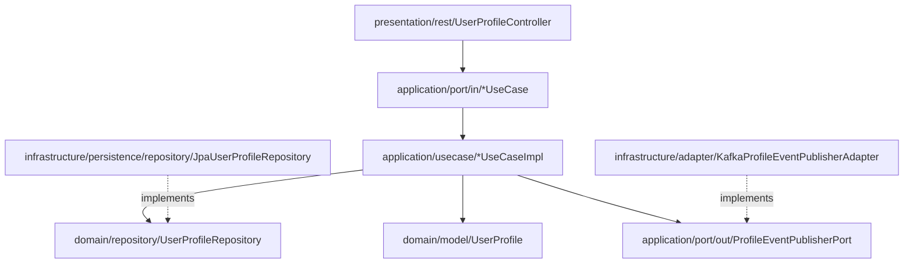

# Fiverr User Service (`fiverr-user-service`)

User profile, freelancer skills, availability, and seller onboarding microservice for **Fiverr Club**, built with **Java 21**, **Spring Boot 3.3.5**, **PostgreSQL**, **Redis**, and **Kafka** following strict **Domain-Driven Design (DDD)** and **Hexagonal Architecture (Ports and Adapters)**.

## Hexagonal Architecture Diagram



## REST API Endpoints

| Method | Path | Description |
|--------|------|-------------|
| `POST` | `/api/v1/profiles` | Create a new user profile linked to an authenticated account |
| `GET` | `/api/v1/profiles/{id}` | Retrieve user profile by profile UUID |
| `GET` | `/api/v1/profiles/account/{accountId}` | Retrieve user profile by Auth Account UUID |
| `GET` | `/api/v1/users/{username}` | Retrieve public user/freelancer profile by username |
| `PUT` | `/api/v1/profiles/{id}` | Update profile bio, skills, languages, country, and availability |
| `POST` | `/api/v1/profiles/{id}/upgrade-seller` | Upgrade buyer profile to a Freelancer Seller profile (`NEW_SELLER`) |
| `GET` | `/api/v1/sellers` | List active freelancer sellers |

## Kubernetes Readiness & Liveness

- Liveness Probe: `GET /actuator/health/liveness`
- Readiness Probe: `GET /actuator/health/readiness`
- Prometheus Metrics: `GET /actuator/prometheus`

## Build & Test

```bash
JAVA_HOME=/opt/homebrew/opt/openjdk@21 mvn clean test
```
